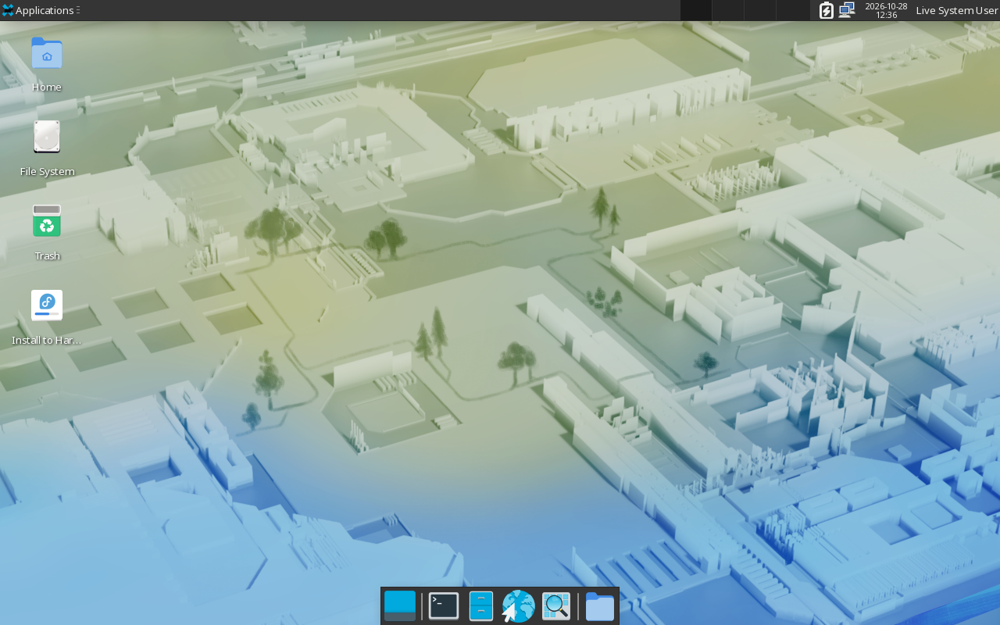
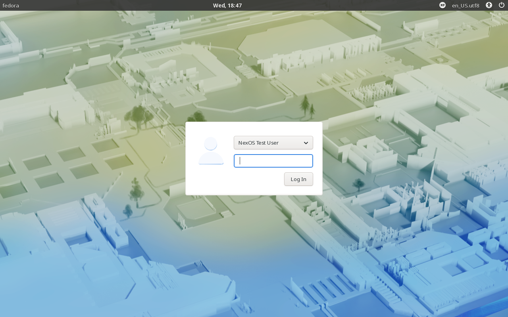
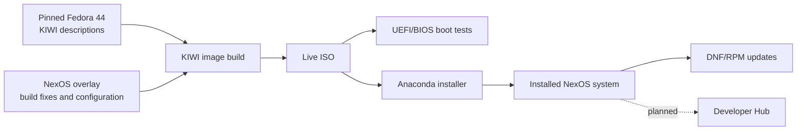
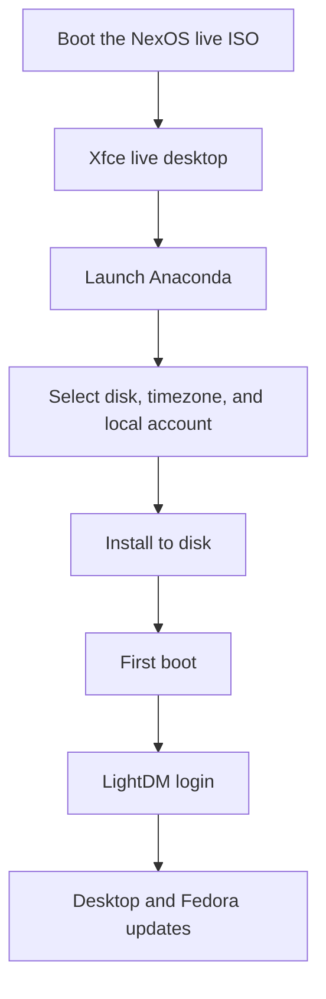

# NexOS

NexOS is an independent, Fedora-based Linux distribution built for developers. It combines the reliability and security of Fedora with a lightweight Xfce desktop, a reproducible image build, and a focused path to a ready-to-use development workstation.

> **Status:** Early development. The Phase 2 baseline is complete and testable in a VM, but NexOS is not release-ready. The current ISO is still Fedora-branded; NexOS branding and the curated developer toolset are planned for later phases.

## Why NexOS exists

Fedora is an excellent general-purpose base, but a fresh install still leaves a developer to assemble the same environment by hand: desktop defaults, terminal tools, language runtimes, editors, and a package workflow. NexOS aims to remove that repetitive setup while keeping Fedora's package ecosystem, security model, and update path.

The project is deliberately built around a few ideas:

- **Developer-first:** provide a practical starting point instead of a generic desktop install.
- **Lightweight:** use Xfce rather than a heavier desktop stack.
- **Local-first:** no mandatory cloud account, telemetry, or online sign-in for normal desktop use.
- **Reproducible:** build the ISO from a pinned Fedora description with a small, auditable NexOS overlay.
- **Transparent:** explain package changes and privileged actions instead of hiding them.
- **Fedora-compatible:** reuse Fedora packages, repositories, Anaconda, DNF, and SELinux rather than inventing a parallel platform.

NexOS is not an official Fedora edition and is not endorsed by or affiliated with the Fedora Project.

## What you get today

The current Phase 2 test ISO is a **Fedora 44 Xfce baseline with the NexOS build fixes**. It is the foundation for the final NexOS image, not yet the complete developer workstation.

### Included in the current test ISO

| Component | Current state |
| --- | --- |
| Base system | Fedora 44, x86_64 |
| Desktop | Xfce 4.20: window manager, panel, desktop, Thunar, terminal, Mousepad, Ristretto |
| Display manager | LightDM login screen |
| Browser | Firefox |
| Installer | Anaconda live installer with local-account creation |
| Package management | DNF5 and RPM |
| Networking | NetworkManager; DHCP, DNS, and outbound connectivity verified in the test VM |
| Security | SELinux Enforcing; RPM GPG signature checks enabled during the build |
| Runtime | Python 3 system runtime (used by Fedora and Anaconda) |
| Accounts | Local user account; no required cloud sign-in |

The current ISO does **not** yet include a curated Git/Node.js/OpenJDK/VS Code toolchain, NexOS themes, NexOS wallpaper, Plank, or the Developer Hub.

### Planned for the first NexOS release

These are roadmap items, not current claims:

- Git, Python 3 with `pip` and virtual environments, Node.js/npm, and OpenJDK.
- Visual Studio Code from an appropriate official source, subject to licensing and redistribution review.
- NexOS light and dark themes, purple accent, wallpaper, and desktop defaults.
- Plank only if it is reliable in the Xfce session.
- The optional Developer Hub GUI and CLI for discovering and installing developer tools.
- NexOS product metadata, ISO labels, and branding that clearly identify the distribution as based on Fedora.

## Requirements

### Running and installing NexOS

NexOS currently targets **64-bit x86_64 PCs**. It does not claim to run on every device; broad hardware support requires testing on real hardware, which has not happened yet.

| Requirement | Current status |
| --- | --- |
| CPU | x86_64 |
| Firmware | UEFI validated for the final Phase 2 ISO; BIOS boot was validated for the Phase 1 ISO |
| RAM | 4 GiB target; the Phase 2 VM used 4 GiB. A minimum has not been established |
| Storage | 20 GiB virtual disk used for the clean install; plan additional space for development tools |
| Display | 1280x800 tested in QEMU; other resolutions are not yet validated |
| Graphics | Basic virtual graphics tested; physical GPUs are not yet validated |
| Network | Not required for the live desktop; required for updates and optional tool installs |
| Secure Boot | Not yet validated |
| Architecture | x86_64 only; ARM64 is a future goal |

Physical hardware, Wi-Fi, audio, suspend/resume, external displays, and Secure Boot still need testing. Until then, use a VM or disposable disk for evaluation. Installation erases the selected disk.

### Building the ISO

Build host: Fedora 44 x86_64 with `sudo` access.

```sh
sudo dnf install kiwi-cli kiwi-systemdeps kiwi-systemdeps-iso-media \
    dracut-kiwi-live distribution-gpg-keys checkpolicy
make clone-vendor     # fetch pinned upstream descriptions (once)
make host-selinux     # install the nexos-kiwi-fix SELinux module (once)
make host-check
make build
```

Artifacts are written to `build/output/build/` (`Fedora.x86_64-44.iso` plus checksum, package, and verification metadata). The Phase 2 test ISO is approximately 3.4 GiB.

Notes:

- `build/nexos-descr/` is generated from the pinned vendor tree plus `build/overlay/`; do not edit it directly.
- Keep SELinux Enforcing. D-010 documents the Fedora `kiwi_t` policy gap and the local module that fixes `%sysusers` scriptlets.
- The live root uses erofs + lzma without fragments (D-014). Packing it is memory-hungry; on a 7.5 GiB host, add swap (12 GiB was used during the baseline build) or `mkfs.erofs` will be OOM-killed.
- RPM GPG signature verification is enabled via `<rpm-check-signatures>true</rpm-check-signatures>` (D-011).

No public release artifact has been published yet; build from source or test the local Phase 2 artifact.

## Screenshots

These screenshots are from the Phase 2 QEMU test environment. Fedora branding is still visible because NexOS branding has not been applied yet.

| Live desktop | Installed-system login |
| --- | --- |
|  |  |

## Architecture diagrams

### Build and delivery pipeline



### User install flow



## Project status

NexOS is in early development. The Phase 2 baseline is complete: the final Fedora 44 Xfce live ISO boots to the desktop under UEFI in QEMU (the earlier Phase 1 ISO also booted under BIOS), and a clean UEFI install boots the installed system with local login, networking, and enforcing SELinux (2026-10-28). Installation is not yet validated on BIOS or physical hardware.

The next phase is NexOS-owned image configuration: product metadata, ISO labels, and branding hooks without editing the pinned vendor tree.

Features and hardware compatibility will be verified through testing; they should not be considered complete until documented and tested.

## Project goals

- Fedora-based operating system
- Lightweight Xfce desktop with NexOS branding
- Light and dark themes with a purple accent
- Guided graphical installation
- Core development tools available out of the box
- Developer Hub with a graphical interface and CLI
- Reproducible ISO builds
- Local user accounts without mandatory cloud sign-in

## Initial target

- Architecture: x86_64
- Base: Fedora 44
- Desktop: Xfce
- Dock: Plank, if reliable
- Package management: DNF and RPM
- Build host: Fedora Linux

ARM64 support is a future goal and is not part of the initial release.

## Repository layout

- `build/` — ISO build configuration and scripts
- `desktop/` — Xfce configuration, themes, and branding
- `apps/` — NexOS applications
- `packaging/` — application packaging
- `config/` — system defaults and configuration
- `docs/` — architecture, setup, and development documentation
- `tests/` — build, ISO, VM, and hardware tests
- `assets/` — logos, screenshots, and brand assets

## Development

See [docs/Architecture.md](docs/Architecture.md) for the architecture. The detailed logs and work history are tracked in [docs/workcompleted.md](docs/workcompleted.md) and decisions in [docs/decisions/decisions.md](docs/decisions/decisions.md). The implementation roadmap is in [docs/implementation.md](docs/implementation.md).

## Contributing

Keep changes small, test them locally, and document any important architectural or security decisions.
